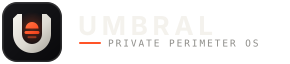
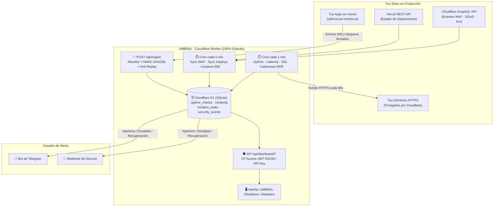
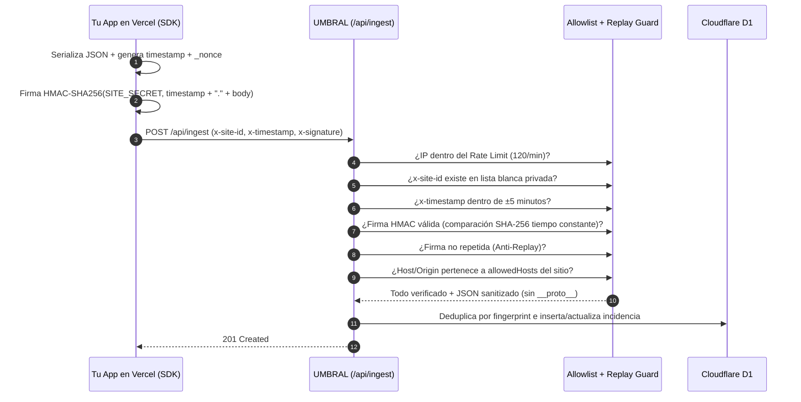

<div align="center">

<br />



<br />
<br />

**[English](./README.md)** · **Español**

<br />

### Observatorio privado de incidencias, disponibilidad y seguridad perimetral

**Vigila exclusivamente tus propias páginas web las 24 horas con costo operativo de \$0/mes.**  
*Disponibilidad · Latencia P50/P95 · Ataques WAF/DDoS · Cabeceras HTTP · Diagnóstico DNS · Alertas en Tiempo Real*

<br />

[](https://workers.cloudflare.com/)
[](https://developers.cloudflare.com/d1/)
[](https://hono.dev/)
[](https://react.dev/)
[](https://tailwindcss.com/)
[](https://www.typescriptlang.org/)
[](./LICENSE)

<br />

[¿Qué es UMBRAL?](#-qué-es-umbral-explicado-para-todos) · [Qué hay detrás](#-qué-hay-detrás-arquitectura-interna) · [Funcionalidades](#-todo-lo-que-hace-umbral) · [Guía de Secretos](#-guía-paso-a-paso-cómo-obtener-cada-secreto) · [Despliegue](#-despliegue-paso-a-paso-desde-cero) · [Política de Seguridad](./SECURITY.md)

</div>

---

## 🧭 ¿Qué es UMBRAL? (Explicado para todos)

Imagina que tienes varias páginas web alojadas en **Vercel** y protegidas por **Cloudflare**. Normalmente, para saber si todo está bien tendrías que revisar varios paneles distintos: uno para ver si la página carga, otro en Cloudflare para ver si te están atacando bots, otro en Vercel para ver si falló el último despliegue y otro en tu código para ver errores internos.

**UMBRAL unifica todo eso en un solo panel privado creado exclusivamente para ti:**

* **Para cualquier usuario propietario de sitios web:** Te dice de un vistazo si tus páginas están funcionando rápido, si alguien intentó atacarlas, si les falta alguna protección de seguridad y te manda un mensaje inmediato a **Telegram** o **Discord** en cuanto algo falla — todo sin pagar mensualidades.
* **Para desarrolladores Junior y Mid:** Es un proyecto *full-stack* moderno en TypeScript (React + Hono + SQLite en Cloudflare D1) organizado en carpetas limpias y separadas por responsabilidad, fácil de leer, probar en local y desplegar con un solo comando.
* **Para ingenieros Senior / SRE / SecOps:** Opera como un plano de control *out-of-band* (independiente de Vercel), con verificación criptográfica `RS256` de JWKS para Cloudflare Access, ingesta firmada con `HMAC-SHA256` + guardia anti-replay, comparación de secretos en tiempo constante, inspección DNS-over-HTTPS (`A`/`AAAA`/`CAA`/`TXT`), cálculo de `MTTR` y presupuesto de error `SLA 99.9%`.

> [!IMPORTANT]
> **¿Por qué UMBRAL se despliega en Cloudflare y NO en Vercel?**  
> Si tus páginas viven en Vercel y alojas tu monitor también en Vercel, el día que Vercel sufra una caída tu monitor caerá junto con tus sitios y jamás podrá avisarte. Al vivir en **Cloudflare Workers + D1**, UMBRAL vigila tus sitios desde afuera las 24 horas y además aprovecha los *Cron Triggers* gratuitos de cada minuto.

---

## ⚙️ ¿Qué hay detrás? (Arquitectura interna)

UMBRAL no necesita servidores encendidos ni bases de datos externas de pago. Todo vive dentro de **un único Cloudflare Worker** que cumple tres funciones simultáneas:

1. **Servidor de la Interfaz Web (SPA):** Entrega el dashboard compilado en React 19 + Tailwind CSS v4 desde el borde global de Cloudflare.
2. **Motor de Recolección Automática (*Cron Triggers*):** Despierta solo en segundo plano cada **1 minuto** y cada **5 minutos** (incluso con tu computadora apagada) para auditar tus dominios y guardar resultados en **Cloudflare D1** (SQLite serverless).
3. **API Privada + Receptor de Telemetría:** Expone `/api/dashboard/*` (protegido para ti) y `/api/ingest` (protegido con firma criptográfica `HMAC-SHA256` para tus apps).



> [!TIP]
> **Superando el límite del plan gratuito de Cloudflare:**  
> En el plan Free de Cloudflare, el historial de eventos del Firewall (WAF) se borra a las **24 horas**. Como el Cron de UMBRAL consulta la API GraphQL cada 5 minutos y guarda cada evento deduplicado en tu base **D1**, pasas a tener **90 días de historial propio** sin pagar un centavo.

---

## 🛠️ Todo lo que hace UMBRAL

| Área | Funcionalidad incluida | Cómo funciona por detrás |
| :--- | :--- | :--- |
| **Disponibilidad (`UP`)** | Detección de caídas reales sin falsas alarmas | Sigue redirecciones legítimas (`301/302/307/308`), exige `https://`, detecta errores de origen Cloudflare (`520`–`526`, `530`) y aplica **histéresis de 2 fallos consecutivos** antes de abrir alerta crítica. Se resuelve sola cuando el sitio vuelve a responder. |
| **Seguridad Perimetral** | Visibilidad de ataques WAF, DDoS, Bots y Rate Limit | Agrupa ataques repetidos bajo un mismo `fingerprint` incrementando un contador (`×N`) para no inundar tu pantalla, mostrando Top IPs, países, acciones y rutas atacadas (`/.env`, `/wp-login.php`, etc.). |
| **Higiene HTTP (`HDR`)** | Calificación automática `/100` de cabeceras | Verifica en cada chequeo `Strict-Transport-Security`, `Content-Security-Policy`, `X-Content-Type-Options` y `X-Frame-Options`. |
| **Diagnóstico Profundo** | Auditoría en vivo DNS + SSL + 7 cabeceras | Consulta **Cloudflare DNS-over-HTTPS (`1.1.1.1`)** para registros `A`, `AAAA`, `CAA` y `SPF/DMARC`, verifica redirección forzada `http:// → https://`, revisa `/.well-known/security.txt` y audita 7 cabeceras modernas. |
| **Operación SRE** | `MTTR`, `SLA 99.9%`, Notas Post-Mortem y Lotes | Calcula tu **Tiempo Medio de Recuperación (30d)**, el margen mensual restante de **SLA 99.9%** (`43.2 min/mes`), permite guardar notas de investigación por incidente y resolver múltiples alertas en un clic. |
| **Modo Mantenimiento** | Silenciado temporal por dominio (`1h`) | Pausa el envío de alertas push (Telegram/Discord) en un sitio específico mientras realizas cambios o despliegues, sin dejar de guardar sus métricas. |
| **Reportes y Alertas** | Probador en vivo + Exportación `CSV` y `JSON` | Botón para enviar una alerta de prueba real a tus canales y descarga directa de incidencias o eventos WAF sanitizada contra inyección de fórmulas en Excel. |
| **Modo Demo Aislado** | Showcase público sin exponer tus sitios | Worker separado (`umbral-demo`) con dominios ficticios `.demo`, simulador de ataques/caídas y analizador público protegido contra **SSRF**. |

---

## 🔐 Modelo de Seguridad multicapa



> [!CAUTION]
> **Regla de oro para repositorios públicos en GitHub:**  
> **NUNCA** escribas contraseñas, tokens ni tus dominios reales dentro de archivos que subas a Git. Usa siempre `.dev.vars` para trabajar en tu computadora (ya está bloqueado en `.gitignore`) y `wrangler secret put` para producción en Cloudflare.

---

## 🔑 Guía paso a paso: cómo obtener cada secreto

A continuación tienes exactamente dónde conseguir cada clave, cuáles son obligatorias y cuáles son opcionales:

| Nombre del Secreto | ¿Obligatorio? | Para qué sirve |
| :--- | :---: | :--- |
| `DASHBOARD_ADMIN_EMAIL` | **Sí** | Tu correo electrónico autorizado como dueño del panel. |
| `DASHBOARD_API_KEY` | **Sí** | Contraseña maestra para desbloquear el dashboard si aún no activas Cloudflare Access. |
| `SITES_CONFIG_JSON` | **Recomendado** | Lista JSON privada con tus dominios reales (para no mostrarlos en GitHub). |
| `CLOUDFLARE_API_TOKEN` | Opcional | Leer ataques WAF, DDoS, bots y picos 5xx de tus dominios en Cloudflare. |
| `SITE_SECRETS_JSON` | Opcional | Claves HMAC para recibir errores `500` y bloqueos desde tus apps en Vercel. |
| `VERCEL_API_TOKEN` | Opcional | Detectar despliegues (`builds`) fallidos en tus proyectos de Vercel. |
| `TELEGRAM_BOT_TOKEN` + `TELEGRAM_CHAT_ID` | Opcional | Recibir alertas críticas gratis e instantáneas en tu celular vía Telegram. |
| `DISCORD_WEBHOOK_URL` | Opcional | Recibir alertas enriquecidas en un canal privado de tu servidor de Discord. |
| `CF_ACCESS_TEAM_DOMAIN` + `CF_ACCESS_AUD` | Opcional | Verificar criptográficamente el login Zero Trust de Cloudflare Access. |

---

### 1️⃣ Cómo obtener tus IDs de sitio (`cloudflareZoneId` y `vercelProjectId`)
1. **Cloudflare Zone ID:** Entra a [dash.cloudflare.com](https://dash.cloudflare.com/) → haz clic en tu dominio → pestaña **Overview** → baja por la columna derecha hasta la sección **API** y copia **Zone ID**.
2. **Vercel Project ID:** Entra a [vercel.com/dashboard](https://vercel.com/dashboard) → entra a tu proyecto → **Settings** → **General** → copia **Project ID** (`prj_...`).

### 2️⃣ Cómo armar `SITES_CONFIG_JSON` (tus sitios privados)
Arma un arreglo JSON **en una sola línea** (incluyendo los corchetes `[` y `]`) con tus propios dominios:

```json
[{"id":"mi-sitio-1","name":"Mi Web Principal","domain":"midominio.com","allowedHosts":["midominio.com","www.midominio.com"],"checkUrl":"https://midominio.com","cloudflareZoneId":"PEGA_TU_ZONE_ID","vercelProjectId":"PEGA_TU_PROJECT_ID"}]
```

### 3️⃣ Cómo sacar `CLOUDFLARE_API_TOKEN` (en plan Free)
1. En Cloudflare haz clic arriba a la derecha en tu perfil → **Profile** → **API Tokens** → **Create Token**.
2. Elige **Start from scratch (Custom)** → **Start with a Zone policy**.
3. Ponle de nombre `UMBRAL Monitor`.
4. En **Zone Resources**, selecciona **`Include` → `All zones`** (o elige solo tus dominios).
5. En **Permissions**, marca únicamente estos **2 permisos de lectura**:
   * `Analytics & Logs` → **`Analytics`** → **`Read`**
   * `App Security` → **`Firewall Services`** → **`Read`**
6. Deja *Token expiration* en **No expiration** y *Client IP filtering* vacío.
7. Pulsa **Continue to summary** → **Create Token** y copia el código generado.

> [!NOTE]
> Este token es estrictamente de **solo lectura**: aun en el peor escenario jamás podría modificar tus registros DNS ni la configuración de tus sitios.

### 4️⃣ Cómo sacar `VERCEL_API_TOKEN`
1. En Vercel ve a tu avatar (arriba a la derecha) → **Account Settings** → **Tokens** (en el menú izquierdo).
2. Pulsa **Create** y llena:
   * **Token Name:** `UMBRAL Monitor`
   * **Scope:** Tu cuenta personal / equipo donde están tus sitios.
   * **Expiration:** `No Expiration` (o `1 Year`).
3. Haz clic en **Create Token** y copia el valor.

### 5️⃣ Cómo generar `SITE_SECRETS_JSON` (para el SDK de Vercel)
Ejecuta este comando en tu terminal (reemplazando los `id` por los mismos `id` que pusiste en tus sitios):

```bash
node -e "const c=require('crypto'); const ids=['mi-sitio-1','mi-sitio-2']; console.log(JSON.stringify(Object.fromEntries(ids.map(id=>[id,c.randomBytes(24).toString('hex')]))));"
```
Copia el JSON resultante (ej. `{"mi-sitio-1":"a8f9...","mi-sitio-2":"91c4..."}`) y guárdalo en un lugar seguro.

### 6️⃣ Cómo sacar `TELEGRAM_BOT_TOKEN` y `TELEGRAM_CHAT_ID` (en 1 minuto)
1. En Telegram busca **`@BotFather`** *(con insignia azul verificada)* y envíale `/newbot`.
2. Escribe un nombre visible (ej. `UMBRAL Alertas`) y luego un usuario terminado en `bot` (ej. `mi_umbral_alertas_bot`).
3. Copia el código que aparece bajo `Use this token to access the HTTP API:` → ese es tu **`TELEGRAM_BOT_TOKEN`**.
4. **Paso indispensable:** Abre el enlace `t.me/tu_bot` que te dio BotFather y pulsa **Iniciar (`/start`)** para autorizar que te envíe mensajes.
5. Ahora busca **`@userinfobot`** en Telegram, pulsa **Iniciar (`/start`)** y copia el número que dice **`Id:`** → ese es tu **`TELEGRAM_CHAT_ID`**.

### 7️⃣ Cómo sacar `DISCORD_WEBHOOK_URL`
1. En tu servidor privado de Discord, pasa el cursor sobre el canal donde quieras recibir alertas y pulsa el **engranaje (`Editar canal`)**.
2. Entra a **Integraciones** → **Webhooks** → **Nuevo Webhook**.
3. Ponle nombre `UMBRAL`, súbele el icono [public/logo-mark.png](public/logo-mark.png) como avatar y pulsa **Copiar URL de webhook**.

---

## 🚀 Despliegue paso a paso desde cero

### Requisitos previos
* Tener instalado **Node.js 20+** y **pnpm** (`npm install -g pnpm`).
* Una cuenta gratuita en [Cloudflare](https://dash.cloudflare.com/sign-up).

---

### Parte A — Probar primero en tu computadora (Modo Local)

```bash
# 1. Clonar el repositorio e instalar dependencias
git clone <URL_DE_TU_REPOSITORIO>
cd <CARPETA_DEL_PROYECTO>
pnpm install

# 2. Crear tu archivo privado de variables locales
cp .dev.vars.example .dev.vars
```

Abre `.dev.vars` en tu editor y rellena tus valores locales. Luego inicializa la base SQLite local:

```bash
# 3. Crear las tablas en la base D1 local
pnpm db:migrate:local

# 4. (Opcional) Cargar incidencias de prueba locales para explorar la interfaz
pnpm db:seed:local

# 5. Compilar el frontend y levantar el Worker en http://127.0.0.1:8787
pnpm build
pnpm dev:worker
```

> [!WARNING]
> En modo local (`pnpm dev:worker`), Cloudflare Wrangler **no dispara los Cron Triggers automáticamente** cada minuto para no consumir recursos de tu PC en segundo plano. Usa el botón bermellón **"Ejecutar escaneo"** dentro del dashboard cada vez que quieras disparar una medición en local.

---

### Parte B — Desplegar en Producción 24/7 (Cloudflare Free)

#### Paso 1: Iniciar sesión y crear tu base de datos D1 remota
```bash
pnpx wrangler login
pnpx wrangler d1 create umbral-incidents-db
```
Si es tu primera vez en Cloudflare Workers, es posible que te pregunte por paquetes a compilar (`esbuild` y `workerd`): márcalos ambos con la barra espaciadora y presiona `Enter`.

Al crear la base, la consola imprimirá un **`database_id`** (con formato UUID `xxxxxxxx-xxxx-...`). Abre [wrangler.jsonc](wrangler.jsonc) y pégalo en el campo `"database_id"` del bloque `"DB"`.

#### Paso 2: Crear las tablas en la nube
```bash
pnpm db:migrate:remote
```

#### Paso 3: Guardar tus secretos cifrados en Cloudflare
Ejecuta uno por uno los secretos que vayas a utilizar. La terminal te pedirá pegar su valor (al pegar no se mostrarán caracteres en pantalla por seguridad; solo presiona `Enter`):

```bash
# Obligatorios / principales:
pnpx wrangler secret put DASHBOARD_ADMIN_EMAIL
pnpx wrangler secret put DASHBOARD_API_KEY
pnpx wrangler secret put SITES_CONFIG_JSON

# Integraciones opcionales (ejecuta solo las que quieras activar):
pnpx wrangler secret put CLOUDFLARE_API_TOKEN
pnpx wrangler secret put SITE_SECRETS_JSON
pnpx wrangler secret put VERCEL_API_TOKEN
pnpx wrangler secret put TELEGRAM_BOT_TOKEN
pnpx wrangler secret put TELEGRAM_CHAT_ID
pnpx wrangler secret put DISCORD_WEBHOOK_URL
```

#### Paso 4: Compilar y publicar todo en un comando
```bash
pnpm deploy
```
¡Listo! Tu observatorio privado ya está en línea ejecutando escaneos automáticos cada 1 y 5 minutos las 24 horas. Entra a la URL que imprime la consola, inicia sesión con tu `DASHBOARD_API_KEY`, abre **Integraciones & SDK** (icono de ajustes en la barra izquierda) y pulsa **"Enviar alerta de prueba"** para verificar que Telegram/Discord te notifican al instante.

#### Paso 5 (Recomendado): Ponerle tu propio subdominio + Cloudflare Access gratis
1. Entra a **Cloudflare → Workers & Pages → `umbral-perimeter-os` → Settings → Domains & Routes**.
2. Haz clic en **Add → Custom Domain**, escribe ej. `umbral.tudominio.com` y desactiva la ruta por defecto `*.workers.dev`.
3. *(Opcional — Máxima seguridad sin contraseñas)*: Entra a **Cloudflare Zero Trust → Access → Applications → Add an application → Self-hosted**, protege `umbral.tudominio.com` permitiendo solo tu correo electrónico, copia el **Application Audience (AUD) Tag** y regístralo:
   ```bash
   pnpx wrangler secret put CF_ACCESS_TEAM_DOMAIN   # ej: tu-equipo.cloudflareaccess.com
   pnpx wrangler secret put CF_ACCESS_AUD           # el AUD Tag copiado
   ```

---

### Parte C — Desplegar una Demo Pública para tu Portafolio (Opcional)

Si quieres compartir un enlace público para mostrar cómo luce y funciona **UMBRAL** sin revelar tus dominios reales ni conectarlo a tu base de datos:

```bash
# Probar la demo pública en local:
pnpm dev:demo

# Publicar como un Worker separado llamado `umbral-demo` (0 secretos, 0 D1 real):
pnpm deploy:demo
```

---

## 🧩 Conectar tus proyectos de Vercel (SDK)

Para que tus aplicaciones en Vercel envíen errores internos `500` o bloqueos de seguridad (como intentos de fuerza bruta en un login) directamente a tu UMBRAL en tiempo real:

1. Copia el archivo [sdk/vercel-monitor.ts](sdk/vercel-monitor.ts) dentro de tu proyecto (por ejemplo en `src/lib/vercel-monitor.ts`). No requiere instalar ningún paquete adicional.
2. En **Vercel → Tu Proyecto → Settings → Environment Variables**, agrega estas 3 variables:
   * `MONITOR_INGEST_URL` = `https://umbral.tudominio.com/api/ingest`
   * `MONITOR_SITE_ID` = el `id` exacto de ese sitio en tu `SITES_CONFIG_JSON`
   * `MONITOR_SITE_SECRET` = la clave correspondiente de ese sitio en tu `SITE_SECRETS_JSON`
3. Úsalo en cualquier API Route, Server Action o Middleware:

```ts
import { reportAppError, reportSecurityBlock } from "@/lib/vercel-monitor";

// Ejemplo 1: Capturar errores 500 en un endpoint
export async function POST(req: Request) {
  try {
    // ... lógica de tu endpoint
    return Response.json({ ok: true });
  } catch (error) {
    await reportAppError(error, req);
    return Response.json({ error: "Internal Server Error" }, { status: 500 });
  }
}

// Ejemplo 2: Reportar bloqueo por fuerza bruta o actividad sospechosa
await reportSecurityBlock(req, "Más de 10 intentos fallidos de inicio de sesión en 1 min.", "high");
```

---

## 🗂️ Estructura limpia del código

```text
.
├── ARCHITECTURE.md                  # Guía de arquitectura para perfiles Junior, Mid y Senior
├── config/
│   └── sites.config.ts              # Plantilla pública de sitios (sobrescrita por SITES_CONFIG_JSON)
├── migrations/
│   ├── 0001_initial.sql             # Tablas principales (uptime, incidents, security_events, state)
│   └── 0002_operational_suite.sql   # Notas post-mortem (incident_notes) y modo mantenimiento
├── public/
│   ├── _headers                     # Cabeceras CSP, HSTS y XFO para activos estáticos
│   ├── logo.svg / logo-mark.svg     # Identidad vectorial oficial de UMBRAL
│   └── logo.png / logo-mark.png     # Exportaciones PNG de alta resolución (Discord / Telegram)
├── sdk/
│   └── vercel-monitor.ts            # Cliente ligero firmado con HMAC-SHA256 para apps en Vercel
├── src/                             # Frontend React 19 + Vite 8 + Tailwind v4
│   ├── styles/                      # Sistema de diseño dual (Obsidiana / Alabastro)
│   ├── types/                       # Contratos TypeScript compartidos en UI
│   ├── constants/                   # Almacenamiento y diccionario de los 30 conceptos del glosario
│   ├── services/                    # Cliente HTTP centralizado (api.client.ts)
│   ├── utils/                       # Exportadores CSV/JSON, duraciones y matemáticas (P50/P95)
│   ├── hooks/                       # useTheme, useKeyboardShortcuts, useDashboardData
│   └── components/                  # Divididos por dominio: brand, ui, layout, overview,
│                                    # incidents, perimeter, telemetry, modals y demo
└── worker/                          # Backend Cloudflare Worker (Hono + D1 + Cron)
    ├── types/                       # Bindings Env y tipos de filas SQL
    ├── constants/                   # Límites defensivos, severidades y política CSP
    ├── security/                    # Allowlist, criptografía tiempo constante, JWT RS256 y Anti-Replay
    ├── middlewares/                 # Cabeceras HTTP, Auth y Rate-Limiting en memoria
    ├── validators/                  # Sanitización de texto y protección Anti-Prototype Pollution
    ├── repositories/                # Consultas SQL D1 puras y parametrizadas
    ├── services/                    # Reglas de negocio (deduplicación, alertas, diagnóstico DNS/HTTP)
    ├── collectors/                  # Recolectores automáticos (uptime 1m, Cloudflare 5m, Vercel 5m)
    ├── demo/                        # Datos ficticios aislados y analizador público Anti-SSRF
    └── routes/                      # Controladores HTTP delgados (health, ingest, dashboard, demo)
```

---

## ⌨️ Atajos y referencia rápida

* **`?`** — Abre el **Manual de Referencia interactivo** integrado con buscador instantáneo (explica `UP`, `HDR`, `DEF`, `P50`, `P95`, `MTTR`, `SLA`, códigos `52x` de Cloudflare y más).
* **`R`** — Refresca inmediatamente todos los indicadores en pantalla.
* **`ESC`** — Cierra cualquier inspector lateral o ventana modal abierta.

---

## 📚 Documentación y Gobernanza del Proyecto

* **[English README](./README.md)** — Main documentation in English.
* **[Guía de Arquitectura](./ARCHITECTURE.md)** — Referencia en capas para perfiles Junior, Mid y Senior.
* **[Política de Seguridad y Avisos](./SECURITY.md)** — Reporte privado de vulnerabilidades (GitHub Security Advisories).
* **[Guía de Contribución](./CONTRIBUTING.md)** — Flujo de desarrollo, convenciones y checklist de Pull Request.
* **[Código de Conducta](./CODE_OF_CONDUCT.md)** — Estándares de convivencia de la comunidad.
* **[Licencia MIT](./LICENSE)** — Términos de uso de código abierto.

---

<div align="center">
  <sub>Diseñado y construido para mantener control total, privacidad absoluta y costo $0/mes sobre Cloudflare Workers + D1.</sub>
</div>
