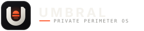
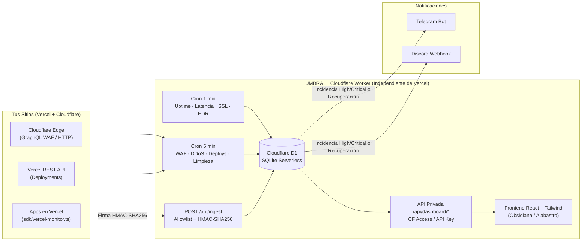

<div align="center">

<br />



<br />
<br />

**Observatorio privado de incidencias, disponibilidad y seguridad perimetral.**  
*Diseñado exclusivamente para tus propias páginas web en Vercel + Cloudflare, operando 24/7 a \$0/mes.*

<br />

[](https://workers.cloudflare.com/)
[](https://hono.dev/)
[](https://developers.cloudflare.com/d1/)
[](https://react.dev/)
[](https://tailwindcss.com/)
[](https://www.typescriptlang.org/)

</div>

---

## ¿Qué es UMBRAL?

**UMBRAL** es un centro de observabilidad y defensa privada pensado para un único propósito: vigilar **exclusivamente tus propios dominios** sin depender de plataformas de terceros ni exponer endpoints públicos de registro.

Corre de forma **independiente en Cloudflare Workers + D1** (fuera de Vercel), lo que garantiza que incluso si Vercel sufre una caída, **UMBRAL** sigue activo para detectarlo, registrarlo y avisarte al instante por **Telegram** o **Discord**.

---

## Capacidades principales

| Módulo | Qué monitorea | Frecuencia | Plan requerido |
| :--- | :--- | :--- | :--- |
| **Disponibilidad y Latencia** | Caídas totales (histéresis de 2 fallos), errores `5xx` y de origen Cloudflare (`520`–`526`, `530`), redirecciones `301/302/307/308` y percentiles **P50 / P95**. | Cada 1 min (Cron) | Cloudflare Free |
| **Seguridad Perimetral (WAF)** | Ataques mitigados por Cloudflare: **DDoS L7**, **WAF**, **Bot Fight Mode** (`managed_challenge`), **Rate Limiting** (`429`), Top IPs y rutas atacadas. Persistido en D1 para superar la retención de 24h del plan gratuito. | Cada 5 min (GraphQL) | Cloudflare Free |
| **Auditoría de Cabeceras (`HDR`)** | Verifica en cada chequeo `HSTS`, `CSP`, `X-Content-Type-Options` y `X-Frame-Options` asignando un puntaje `/100`. | Cada 1 min | Cloudflare Free |
| **Despliegues de Vercel** | Consulta la REST API de Vercel para detectar builds en estado `ERROR` o `CANCELED` y los cierra automáticamente al volver a `READY`. | Cada 5 min | Vercel Hobby (Free) |
| **Telemetría de Aplicación** | Errores internos `500`, fuerza bruta en login y bloqueos propios enviados desde tus apps con firma **HMAC-SHA256**. | Tiempo real | Vercel Hobby (Free) |
| **Alertas Instantáneas** | Notificaciones push cuando se abre, escala o resuelve una incidencia `high` o `critical`. | Tiempo real | Telegram / Discord (Gratis) |

---

## Arquitectura



---

## Seguridad: cerrado 100% a tus dominios

1. **Lista blanca estática en código ([config/sites.config.ts](config/sites.config.ts)):** No existe ningún endpoint ni interfaz pública para registrar sitios externos.
2. **Validación estricta por canal:**
   - El monitor de uptime solo consulta las URLs declaradas en `MY_SITES`.
   - El recolector de Cloudflare solo consulta tus `cloudflareZoneId` y descarta cualquier `host` ajeno a `allowedHosts`.
   - `POST /api/ingest` exige `x-site-id` permitido, `x-timestamp` vigente (±5 min anti-replay), firma `HMAC-SHA256` única por sitio y `Origin`/`host` coincidente.
3. **Acceso privado al dashboard:** Protegido con **Cloudflare Access (Zero Trust)** + verificación opcional de correo administrador (`DASHBOARD_ADMIN_EMAIL`) o clave `DASHBOARD_API_KEY`.
4. **Sin Preview URLs públicas:** `"preview_urls": false` en `wrangler.jsonc` para evitar exposición fuera de tu subdominio privado.

---

## Interfaz y Experiencia (2026–2027)

* **Sistema dual de temas:** **Obsidiana Cálida** (modo oscuro táctil sin tinte azulado) y **Alabastro Arquitectónico** (modo claro editorial).
* **Brújula de Salud SVG (`SCORE / 100`):** Ponderación `45% UP + 25% HDR + 30% DEF`.
* **Inspector deslizante de incidencias:** Cronología, IPs bloqueadas, rutas objetivo, cabeceras faltantes, payload JSON y acciones rápidas (`Investigar` / `Resolver` / `Reabrir`).
* **Glosario interactivo integrado:** Tooltips `?` en cada métrica y panel buscable con la explicación de todos los estados, siglas y códigos `52x`.
* **Atajos de teclado:** `R` refresca datos · `?` abre la guía de métricas · `ESC` cierra paneles.

---

## Estructura del proyecto

```text
.
├── ARCHITECTURE.md              # Guía clara para desarrolladores Junior, Mid y Senior
├── config/
│   └── sites.config.ts          # Lista blanca estricta de tus dominios propios
├── migrations/
│   └── 0001_initial.sql         # Esquema SQLite para Cloudflare D1
├── public/
│   ├── _headers                 # Cabeceras CSP, HSTS y XFO para activos estáticos
│   ├── logo.svg                 # Logotipo vectorial completo
│   ├── logo-mark.svg            # Isotipo / Favicon SVG
│   ├── logo.png                 # Logotipo horizontal PNG (1120x256)
│   └── logo-mark.png            # Avatar PNG (512x512) para Discord/Telegram
├── sdk/
│   └── vercel-monitor.ts        # Helper sin dependencias para tus apps en Vercel
├── scripts/
│   └── seed_local.sql           # Datos demo opcionales (solo local)
├── src/                         # Frontend React 19 + Vite + Tailwind v4
│   ├── styles/                  # Tokens de diseño dual (Obsidiana / Alabastro)
│   ├── types/                   # Contratos TypeScript del cliente
│   ├── constants/               # Claves de sesión y diccionario del glosario
│   ├── services/                # Cliente HTTP tipado (api.client.ts)
│   ├── utils/                   # Formateadores y matemáticas (percentiles / arcos SVG)
│   ├── hooks/                   # useTheme, useKeyboardShortcuts, useDashboardData
│   └── components/              # Agrupados por dominio (brand, ui, layout, overview, incidents, perimeter, telemetry, modals)
└── worker/                      # Backend Cloudflare Worker (Hono + D1 + Cron)
    ├── types/                   # Definiciones Env y modelos D1
    ├── constants/               # Límites de seguridad, CSP y enums válidos
    ├── security/                # Allowlist, HMAC tiempo constante, JWT CF Access y Anti-Replay
    ├── middlewares/             # Cabeceras HTTP, Auth y Rate-Limiting
    ├── validators/              # Sanitización y protección contra Prototype Pollution
    ├── repositories/            # Consultas SQL parametrizadas puras hacia D1
    ├── services/                # Lógica de negocio (deduplicación, alertas, KPIs)
    ├── collectors/              # Sondas automáticas (uptime 1m, Cloudflare 5m, Vercel 5m)
    └── routes/                  # Controladores HTTP delgados (health, ingest, dashboard)
```

---

## Desarrollo local

```bash
# 1. Instalar dependencias
pnpm install

# 2. Copiar plantilla de variables locales (nunca se sube a Git)
cp .dev.vars.example .dev.vars

# 3. Aplicar migración D1 en local
pnpm db:migrate:local

# 4. (Opcional) Cargar datos de demostración en local
pnpm db:seed:local

# 5. Compilar frontend y levantar el Worker local en http://127.0.0.1:8787
pnpm build
pnpm dev:worker
```

*(Para desarrollo con hot-reload del frontend, corre `pnpm dev:worker` en una terminal y `pnpm dev:web` en otra).*

---

## Despliegue en producción (Cloudflare Free)

### 1. Registrar tus dominios
* **Si tu repo en GitHub es público (recomendado):** mantén tus dominios reales fuera del código usando el secreto **`SITES_CONFIG_JSON`** (`pnpx wrangler secret put SITES_CONFIG_JSON` en Cloudflare y en tu `.dev.vars` local).
* **Si tu repo es privado:** puedes editar directamente [config/sites.config.ts](config/sites.config.ts) con tus dominios, `cloudflareZoneId` y `vercelProjectId`.

### 2. Crear D1 y aplicar migraciones
```bash
pnpx wrangler login
pnpx wrangler d1 create umbral-incidents-db
# Copia el database_id generado en wrangler.jsonc

pnpm db:migrate:remote
```

### 3. Cargar secretos en Cloudflare
```bash
pnpx wrangler secret put DASHBOARD_ADMIN_EMAIL
pnpx wrangler secret put DASHBOARD_API_KEY
pnpx wrangler secret put CLOUDFLARE_API_TOKEN
pnpx wrangler secret put SITE_SECRETS_JSON

# Opcionales:
pnpx wrangler secret put VERCEL_API_TOKEN
pnpx wrangler secret put TELEGRAM_BOT_TOKEN
pnpx wrangler secret put TELEGRAM_CHAT_ID
pnpx wrangler secret put DISCORD_WEBHOOK_URL
```

* **Permisos del `CLOUDFLARE_API_TOKEN` (solo lectura):** `Zone → Analytics: Read` y `Zone → Firewall Services: Read` sobre tus zonas.
* **Generar `SITE_SECRETS_JSON` seguro:**
  ```bash
  node -e "const c=require('crypto'); const ids=['mi-web-principal','mi-app']; console.log(JSON.stringify(Object.fromEntries(ids.map(id=>[id,c.randomBytes(24).toString('hex')]))));"
  ```

### 4. Desplegar
```bash
pnpm deploy
```

### Desplegar versión Demo Pública (`umbral-demo`)
Si deseas publicar una demostración interactiva sin exponer tus dominios reales, tu base D1 ni ningún secreto:
```bash
# Probar la demo en local
pnpm dev:demo

# Desplegar como Worker independiente `umbral-demo` (DEMO_MODE=true, 0 secretos, 0 D1 real)
pnpm deploy:demo
```
Incluye 4 dominios ficticios (`.demo`), simulador de ataques WAF / caídas `522` y un analizador de páginas públicas en vivo protegido contra SSRF (máx. 5 pruebas/min/IP).

### 5. Subdominio propio + Cloudflare Access (Recomendado)
1. En **Cloudflare → Workers & Pages → `umbral-perimeter-os` → Settings → Domains & Routes**, añade un **Custom Domain** (ej. `umbral.tudominio.com`) y desactiva `*.workers.dev`.
2. En **Cloudflare Zero Trust → Access → Applications → Self-hosted**, protege ese subdominio con una política **Allow** exclusiva para tu correo electrónico.

---

## Conectar tus proyectos de Vercel (SDK opcional)

1. Copia [sdk/vercel-monitor.ts](sdk/vercel-monitor.ts) dentro de tu proyecto en Vercel (ej. `src/lib/vercel-monitor.ts`).
2. Agrega estas variables en **Vercel → Project Settings → Environment Variables**:
   - `MONITOR_INGEST_URL`: `https://umbral.tudominio.com/api/ingest`
   - `MONITOR_SITE_ID`: el `id` exacto en `config/sites.config.ts`
   - `MONITOR_SITE_SECRET`: la clave de ese sitio en `SITE_SECRETS_JSON`
3. Reporta errores `500` o bloqueos desde tus Route Handlers / Middleware:

```ts
import { reportAppError, reportSecurityBlock } from "@/lib/vercel-monitor";

// En un catch de API Route:
await reportAppError(error, req);

// Al bloquear fuerza bruta o abuso:
await reportSecurityBlock(req, "Más de 10 intentos fallidos en 1 minuto.", "high");
```

---

## Glosario rápido de métricas

| Indicador | Significado |
| :--- | :--- |
| **`UP`** | Disponibilidad porcentual de los últimos chequeos HTTP en 24h. |
| **`HDR`** | Higiene de cabeceras de seguridad (`HSTS`, `CSP`, `X-Content-Type-Options`, `X-Frame-Options`). Cada ausente resta 25 pts. |
| **`DEF`** | Índice de calma operativa frente a incidencias activas (100 sin alertas abiertas). |
| **`P50` / `P95`** | Mediana de latencia típica (`P50`) y latencia del 95% más rápido (`P95`, útil para detectar *cold starts*). |
| **`×N`** | Ocurrencias agrupadas automáticamente bajo el mismo `fingerprint` para evitar spam de alertas. |

---

<div align="center">
  <sub>Construido con enfoque de seguridad privada y costo operativo $0/mes sobre Cloudflare Workers + D1.</sub>
</div>
