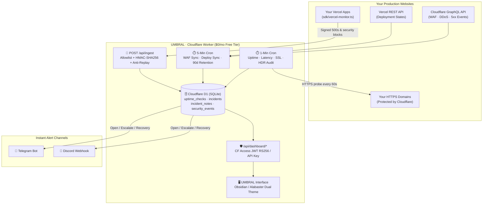
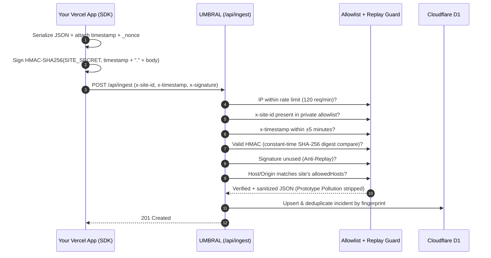

<div align="center">

<br />


<br />
<br />

**English** · **[Español](./README.es.md)**

<br />

### Private Incident, Uptime & Perimeter Security Observatory

**Monitor exclusively your own websites 24/7 at \$0/month operational cost.**  
*Availability · P50/P95 Latency · WAF/DDoS Defense · HTTP Headers Audit · Live DNS Diagnostics · Instant Alerts*

<br />

[](https://workers.cloudflare.com/)
[](https://developers.cloudflare.com/d1/)
[](https://hono.dev/)
[](https://react.dev/)
[](https://tailwindcss.com/)
[](https://www.typescriptlang.org/)
[](./LICENSE)

<br />

[Overview](#-what-is-umbral-explained-for-everyone) · [Under the Hood](#-under-the-hood-architecture) · [Features](#-complete-feature-suite) · [Secrets Guide](#-step-by-step-guide-how-to-obtain-every-secret) · [Deployment](#-step-by-step-deployment-from-scratch) · [Security Policy](./SECURITY.md)

</div>

---

## 🧭 What is UMBRAL? (Explained for Everyone)

Suppose you host websites on **Vercel** and protect your domains with **Cloudflare**. Normally, knowing what is happening requires jumping across multiple dashboards: one to check if your site is online, another in Cloudflare to see if bots or DDoS attacks are hitting your endpoints, another in Vercel to check if a deployment broke, and your application logs to catch `500` errors.

**UMBRAL brings all of that into a single private observatory built strictly for your own domains:**

* **For everyday website owners:** See at a glance whether your sites are fast and online, whether attackers were blocked at the perimeter, whether any security protection is missing, and receive an instant notification on **Telegram** or **Discord** the moment something goes wrong — at **$0/month**.
* **For Junior & Mid-level developers:** A clean, modern full-stack TypeScript codebase (React 19 + Hono + Cloudflare D1 SQLite) structured into single-responsibility folders (`routes`, `services`, `repositories`, `security`, `hooks`, domain `components`) that is easy to read, run locally in 2 minutes, and deploy with one command.
* **For Senior / SRE / SecOps engineers:** An *out-of-band* monitoring plane running outside Vercel on Cloudflare's edge, featuring cryptographic `RS256` JWKS verification for Cloudflare Access, `HMAC-SHA256` signed telemetry with constant-time SHA-256 digest comparison and signature replay protection, live DNS-over-HTTPS (`A`/`AAAA`/`CAA`/`TXT`) inspection, 30-day `MTTR`, and monthly `99.9% SLA` error budget tracking.

> [!IMPORTANT]
> **Why deploy UMBRAL on Cloudflare instead of Vercel?**  
> If your websites live on Vercel and your monitor also lives on Vercel, a platform outage on Vercel takes down your monitor at the exact moment you need it most. Hosting UMBRAL on **Cloudflare Workers + D1** keeps your observatory completely independent, provides free 1-minute *Cron Triggers*, and includes 5 GB of serverless SQLite storage at $0/month.

---

## ⚙️ Under the Hood (Architecture)

UMBRAL requires zero always-on VMs and zero paid external databases. Everything runs inside **a single Cloudflare Worker** performing three roles simultaneously:

1. **Static SPA Host:** Serves the compiled React 19 + Tailwind CSS v4 interface directly from Cloudflare's global edge.
2. **Autonomous Collector Engine (*Cron Triggers*):** Wakes up automatically every **1 minute** and every **5 minutes** (24/7, even when your computer is off) to probe your domains, sync security events, and persist history into **Cloudflare D1**.
3. **Hardened API & Signed Telemetry Receiver:** Serves `/api/dashboard/*` (private owner endpoints) and `/api/ingest` (`HMAC-SHA256` signed ingestion for your Vercel apps).



> [!TIP]
> **Bypassing Cloudflare Free's 24-hour WAF retention limit:**  
> On the Cloudflare Free plan, Firewall (WAF) events expire after **24 hours**. Because UMBRAL's 5-minute Cron polls the GraphQL API and stores deduplicated events inside your own **D1** database, you retain **90 days of searchable security history** for free.

---

## 🛠️ Complete Feature Suite

| Domain | Capability | How It Works Under the Hood |
| :--- | :--- | :--- |
| **Availability (`UP`)** | False-positive-free outage detection | Follows valid redirects (`301/302/307/308`), enforces `https://`, detects Cloudflare origin errors (`520`–`526`, `530`), and applies **2-check consecutive failure hysteresis** before opening a critical incident. Auto-resolves upon recovery. |
| **Perimeter Defense** | WAF, DDoS L7, Bots & Rate-Limit intelligence | Deduplicates repeated attacks under a deterministic `fingerprint` (`×N` counter) to prevent alert fatigue, surfacing Top Mitigated IPs, countries, mitigation actions, and targeted paths (`/.env`, `/wp-login.php`). |
| **Header Hygiene (`HDR`)** | Automated `/100` HTTP security grading | Audits `Strict-Transport-Security`, `Content-Security-Policy`, `X-Content-Type-Options`, and `X-Frame-Options` on every probe. |
| **Deep Diagnostics** | Live on-demand DNS + SSL + 7-header audit | Queries **Cloudflare DNS-over-HTTPS (`1.1.1.1`)** for `A`, `AAAA`, `CAA`, and `SPF/DMARC` records, checks mandatory `http:// → https://` redirection, verifies `/.well-known/security.txt`, and inspects 7 modern security headers. |
| **SRE Operations** | `MTTR`, `99.9% SLA`, Post-Mortem Notes & Bulk Actions | Computes real 30-day **Mean Time To Recovery**, tracks monthly **99.9% SLA error budget** (`43.2 min/mo`), stores timestamped investigation notes per incident, and resolves filtered incidents in bulk. |
| **Maintenance Mode** | Per-domain alert muting (`1h` window) | Temporarily suppresses outbound Telegram/Discord notifications on a specific site during planned deployments or DNS changes while continuing to record telemetry. |
| **Reporting & Testing** | 1-click Live Alert Tester + `CSV` / `JSON` Export | Send a live test ping to Telegram/Discord from the UI and export filtered incidents or security events (hardened against CSV formula injection). |
| **Isolated Demo Mode** | Public portfolio showcase with zero real data | Dedicated `umbral-demo` Worker configuration serving fictional `.demo` domains, interactive attack/outage simulators, and an **Anti-SSRF** live public URL analyzer. |

---

## 🔐 Multi-Layer Security Model



> [!CAUTION]
> **Golden Rule for Public GitHub Repositories:**  
> **NEVER** commit API keys, tokens, or your real domain list to Git. Keep local secrets inside `.dev.vars` (ignored by `.gitignore`) and production secrets inside Cloudflare Secrets (`wrangler secret put`).

---

## 🔑 Step-by-Step Guide: How to Obtain Every Secret

| Secret Name | Required? | Purpose |
| :--- | :---: | :--- |
| `DASHBOARD_ADMIN_EMAIL` | **Yes** | Your authorized owner email address. |
| `DASHBOARD_API_KEY` | **Yes** | Master passphrase to unlock the dashboard when not behind Cloudflare Access. |
| `SITES_CONFIG_JSON` | **Recommended** | Private JSON array of your real domains (keeps your domains out of GitHub). |
| `CLOUDFLARE_API_TOKEN` | Optional | Read WAF, DDoS, bot, and 5xx analytics for your Cloudflare zones. |
| `SITE_SECRETS_JSON` | Optional | Per-site HMAC secrets to receive real-time `500` errors & blocks from Vercel. |
| `VERCEL_API_TOKEN` | Optional | Detect failed or canceled deployments across your Vercel projects. |
| `TELEGRAM_BOT_TOKEN` + `TELEGRAM_CHAT_ID` | Optional | Receive free, instant push alerts on your phone via Telegram. |
| `DISCORD_WEBHOOK_URL` | Optional | Receive rich embed alerts in a private Discord channel. |
| `CF_ACCESS_TEAM_DOMAIN` + `CF_ACCESS_AUD` | Optional | Cryptographically verify Cloudflare Zero Trust Access JWTs (`RS256`). |

---

### 1️⃣ Finding your `cloudflareZoneId` & `vercelProjectId`
1. **Cloudflare Zone ID:** Log in to [dash.cloudflare.com](https://dash.cloudflare.com/) → select your domain → **Overview** tab → scroll down the right sidebar to **API** → copy **Zone ID**.
2. **Vercel Project ID:** Log in to [vercel.com/dashboard](https://vercel.com/dashboard) → select your project → **Settings** → **General** → copy **Project ID** (`prj_...`).

### 2️⃣ Building `SITES_CONFIG_JSON` (Your Private Domain Allowlist)
Format your domains as a **single-line JSON array** (including the outer `[` and `]` brackets):

```json
[{"id":"my-main-site","name":"Main Website","domain":"yourdomain.com","allowedHosts":["yourdomain.com","www.yourdomain.com"],"checkUrl":"https://yourdomain.com","cloudflareZoneId":"PASTE_ZONE_ID","vercelProjectId":"PASTE_PROJECT_ID"}]
```

### 3️⃣ Creating `CLOUDFLARE_API_TOKEN` (Free Plan Compatible)
1. In Cloudflare, click your top-right profile icon → **Profile** → **API Tokens** → **Create Token**.
2. Choose **Start from scratch (Custom)** → **Start with a Zone policy**.
3. Name it `UMBRAL Monitor`.
4. Under **Zone Resources**, select **`Include` → `All zones`** (or pick your specific zones).
5. Under **Permissions**, grant **only these 2 read-only permissions**:
   * `Analytics & Logs` → **`Analytics`** → **`Read`**
   * `App Security` → **`Firewall Services`** → **`Read`**
6. Keep *Token expiration* set to **No expiration** and leave *Client IP filtering* blank.
7. Click **Continue to summary** → **Create Token** and copy the token.

> [!NOTE]
> This token is strictly **read-only**: it cannot alter DNS records, firewall rules, or Worker settings.

### 4️⃣ Creating `VERCEL_API_TOKEN`
1. In Vercel, click your avatar (top right) → **Account Settings** → **Tokens**.
2. Click **Create**, name it `UMBRAL Monitor`, choose your personal account/team scope, set **No Expiration** (or `1 Year`), click **Create Token**, and copy it.

### 5️⃣ Generating `SITE_SECRETS_JSON` (For the Vercel SDK)
Run this one-liner in your terminal (replacing the IDs with the `id` values from your sites):

```bash
node -e "const c=require('crypto'); const ids=['my-main-site','my-app']; console.log(JSON.stringify(Object.fromEntries(ids.map(id=>[id,c.randomBytes(24).toString('hex')]))));"
```

### 6️⃣ Getting `TELEGRAM_BOT_TOKEN` & `TELEGRAM_CHAT_ID` (Under 1 Minute)
1. Open Telegram, search for **`@BotFather`** *(verified blue check)*, and send `/newbot`.
2. Enter a display name (e.g., `UMBRAL Alerts`) and a username ending in `bot` (e.g., `my_umbral_alerts_bot`).
3. Copy the token printed under `Use this token to access the HTTP API:` → **`TELEGRAM_BOT_TOKEN`**.
4. **Required:** Click the `t.me/your_bot` link in BotFather's reply and press **Start (`/start`)** so the bot is allowed to message you.
5. Search for **`@userinfobot`** in Telegram, press **Start (`/start`)**, and copy the numeric **`Id:`** → **`TELEGRAM_CHAT_ID`**.

### 7️⃣ Getting `DISCORD_WEBHOOK_URL`
1. In your private Discord server, click the **gear icon (`Edit Channel`)** next to your alerts channel.
2. Go to **Integrations** → **Webhooks** → **New Webhook**.
3. Name it `UMBRAL`, upload [public/logo-mark.png](public/logo-mark.png) as the avatar, and click **Copy Webhook URL**.

---

## 🚀 Step-by-Step Deployment from Scratch

### Prerequisites
* **Node.js 20+** and **pnpm** (`npm install -g pnpm`).
* A free [Cloudflare](https://dash.cloudflare.com/sign-up) account.

---

### Part A — Local Development (Run in 2 Minutes)

```bash
# 1. Clone the repository and install dependencies
git clone <YOUR_REPO_URL>
cd <PROJECT_FOLDER>
pnpm install

# 2. Create your local environment file (gitignored)
cp .dev.vars.example .dev.vars
```

Edit `.dev.vars` with your local values, then initialize the local D1 SQLite database:

```bash
# 3. Apply D1 schema migrations locally
pnpm db:migrate:local

# 4. (Optional) Seed local sample data to explore the UI immediately
pnpm db:seed:local

# 5. Build frontend assets and start the local Worker at http://127.0.0.1:8787
pnpm build
pnpm dev:worker
```

> [!WARNING]
> During local development (`pnpm dev:worker`), Wrangler **does not auto-fire Cron Triggers** every minute in the background. Click the vermilion **"Ejecutar escaneo"** button in the UI whenever you want to trigger a live check locally.

---

### Part B — 24/7 Production Deployment (Cloudflare Free)

#### Step 1: Authenticate & create your remote D1 database
```bash
pnpx wrangler login
pnpx wrangler d1 create umbral-incidents-db
```
Copy the UUID **`database_id`** printed in your terminal and paste it into `"database_id"` inside [wrangler.jsonc](wrangler.jsonc).

#### Step 2: Apply database migrations to Cloudflare D1
```bash
pnpm db:migrate:remote
```

#### Step 3: Upload your encrypted secrets to Cloudflare
Run each command below for the secrets you want to enable (characters are hidden while pasting; press `Enter` to save):

```bash
# Core secrets:
pnpx wrangler secret put DASHBOARD_ADMIN_EMAIL
pnpx wrangler secret put DASHBOARD_API_KEY
pnpx wrangler secret put SITES_CONFIG_JSON

# Optional integrations:
pnpx wrangler secret put CLOUDFLARE_API_TOKEN
pnpx wrangler secret put SITE_SECRETS_JSON
pnpx wrangler secret put VERCEL_API_TOKEN
pnpx wrangler secret put TELEGRAM_BOT_TOKEN
pnpx wrangler secret put TELEGRAM_CHAT_ID
pnpx wrangler secret put DISCORD_WEBHOOK_URL
```

#### Step 4: Build & deploy everything in one command
```bash
pnpm deploy
```
Your private observatory is now live 24/7! Open your Worker URL, unlock it with `DASHBOARD_API_KEY`, open **Integraciones & SDK**, and click **"Enviar alerta de prueba"** to verify instant Telegram/Discord delivery.

#### Step 5 (Recommended): Custom Subdomain + Cloudflare Zero Trust Access
1. In **Cloudflare → Workers & Pages → `umbral-perimeter-os` → Settings → Domains & Routes**, add a **Custom Domain** (e.g., `umbral.yourdomain.com`) and disable the default `*.workers.dev` route.
2. In **Cloudflare Zero Trust → Access → Applications → Add an application → Self-hosted**, protect `umbral.yourdomain.com` with an **Allow** policy restricted to your email, then bind cryptographic JWT verification:
   ```bash
   pnpx wrangler secret put CF_ACCESS_TEAM_DOMAIN   # e.g. your-team.cloudflareaccess.com
   pnpx wrangler secret put CF_ACCESS_AUD           # Application Audience (AUD) Tag
   ```

---

### Part C — Deploying an Isolated Public Demo (Optional)

Want to share a live portfolio showcase of UMBRAL without exposing any real domains, D1 data, or secrets?

```bash
# Preview Demo Mode locally:
pnpm dev:demo

# Deploy as a standalone `umbral-demo` Worker (DEMO_MODE=true, 0 secrets, 0 D1):
pnpm deploy:demo
```

---

## 🧩 Connecting Your Vercel Projects (SDK)

1. Copy [sdk/vercel-monitor.ts](sdk/vercel-monitor.ts) into your Vercel project (e.g., `src/lib/vercel-monitor.ts`). Zero external dependencies required.
2. Add three environment variables in **Vercel → Project Settings → Environment Variables**:
   * `MONITOR_INGEST_URL` = `https://umbral.yourdomain.com/api/ingest`
   * `MONITOR_SITE_ID` = exact site `id` from `SITES_CONFIG_JSON`
   * `MONITOR_SITE_SECRET` = matching secret from `SITE_SECRETS_JSON`
3. Report `500` exceptions or security blocks from any Route Handler or Middleware:

```ts
import { reportAppError, reportSecurityBlock } from "@/lib/vercel-monitor";

export async function POST(req: Request) {
  try {
    // ... your handler logic
    return Response.json({ ok: true });
  } catch (error) {
    await reportAppError(error, req);
    return Response.json({ error: "Internal Server Error" }, { status: 500 });
  }
}

// Or report brute-force / rate-limit blocks:
await reportSecurityBlock(req, "Blocked >10 failed login attempts in 60s.", "high");
```

---

## 📚 Project Documentation & Governance

* **[README en Español](./README.es.md)** — Documentación completa en español.
* **[Architecture Guide](./ARCHITECTURE.md)** — Layered architecture reference for Junior, Mid, and Senior developers.
* **[Security Policy & Advisories](./SECURITY.md)** — Responsible disclosure process and security controls.
* **[Contributing Guide](./CONTRIBUTING.md)** — Development workflow, coding standards, and PR checklist.
* **[Code of Conduct](./CODE_OF_CONDUCT.md)** — Community standards (Contributor Covenant v2.1).
* **[MIT License](./LICENSE)** — Open-source licensing terms.

---

<div align="center">
  <sub>Built for complete sovereignty, strict privacy, and $0/mo operations on Cloudflare Workers + D1.</sub>
</div>
